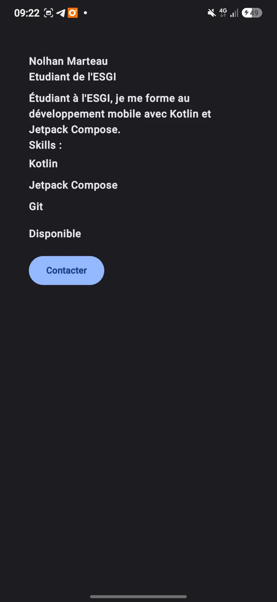
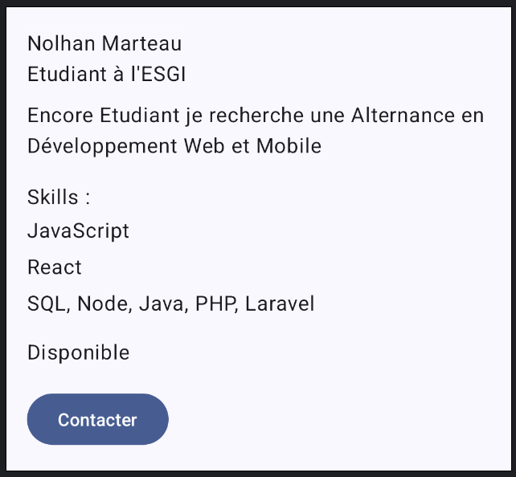
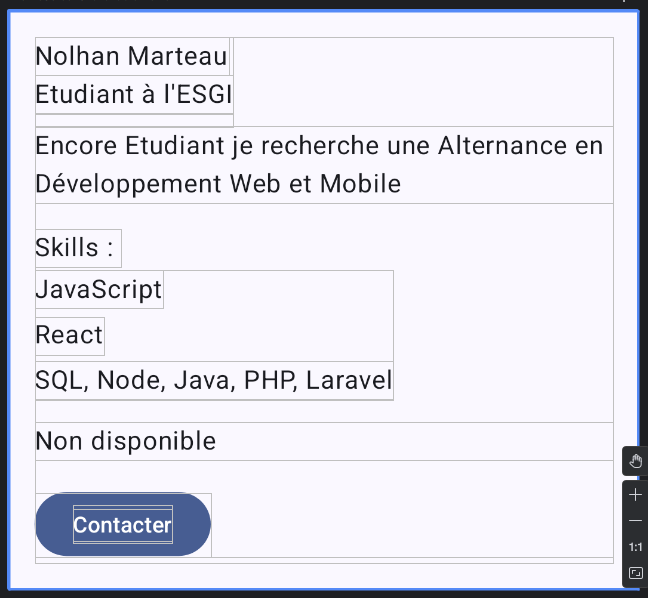

# Profil développeur Compose

## Description

Application Android en Jetpack Compose qui affiche une fiche « Profil développeur » : nom, rôle, description, liste de compétences et disponibilité.
L'utilisateur peut cliquer sur la zone de disponibilité ou sur le bouton « Contacter ».
L'écran est découpé en composables réutilisables, avec deux previews montrant deux profils différents.

## Notions utilisées

- Composables et paramètres
- `Modifier` et chaînage de modifiers
- Padding externe / interne
- Callbacks
- `Scaffold` et `innerPadding`
- Previews
- Accessibilité de base (`semantics`, `Role.Button`, `contentDescription`)

## Explication

1. **Composables créés :** `ProfileScreen`, `ProfileCard`, `ProfileHeader`, `SkillItem`, `AvailabilityInfo`, `ContactButton`.
2. **Écran principal :** `ProfileScreen`, appelé dans `MainActivity` avec le `innerPadding` du `Scaffold`.
3. **Padding externe :** dans `ProfileScreen`, qui passe `modifier.fillMaxWidth().padding(24.dp)` à `ProfileCard` : le parent place la carte dans l'écran.
4. **Padding interne :** dans `ProfileCard`, la `Column` à l'intérieur de la `Surface` a un `padding(16.dp)` : la carte espace son propre contenu.
5. **Callback :** `ContactButton` et `AvailabilityInfo` reçoivent un `onClick`. Ils signalent le clic, la logique est fournie par `ProfileScreen`.
6. **Accessibilité :** `AvailabilityInfo` est une zone cliquable personnalisée, donc j'ai ajouté `semantics` avec `role = Role.Button` et une `contentDescription`. Le `ContactButton` utilise un `Button`, qui indique déjà son rôle aux lecteurs d'écran.
7. **Réutilisabilité :** les composants reçoivent leurs données en paramètres et acceptent un `modifier: Modifier = Modifier`. Ils peuvent donc afficher n'importe quel profil, comme le montrent les deux previews.

## Captures

**Application lancée**

**Previews**

 

## Lien du dépôt

https://github.com/MNolhan/ProfilDeveloppeur
